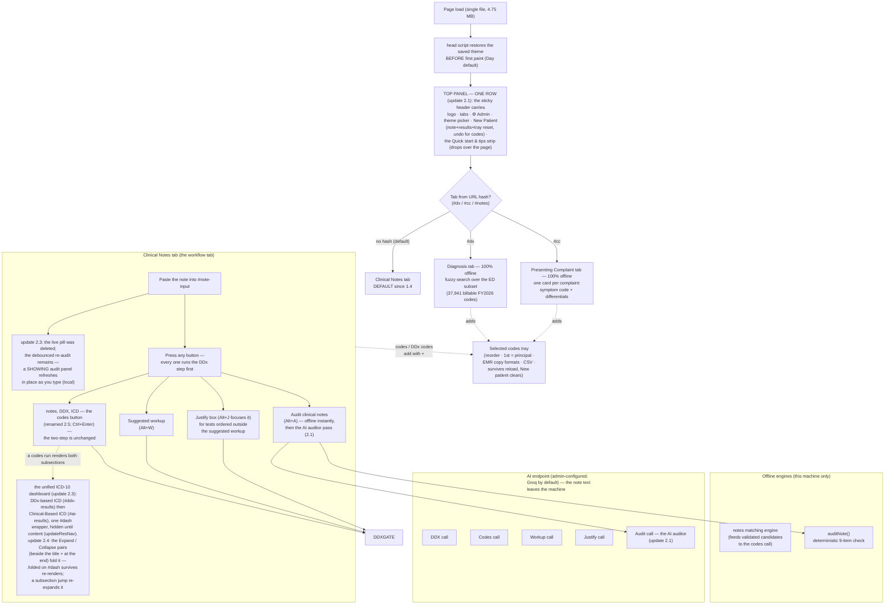
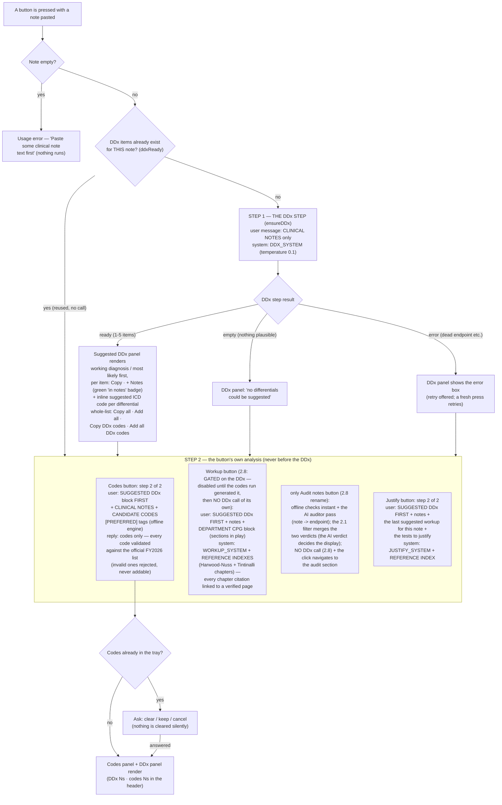
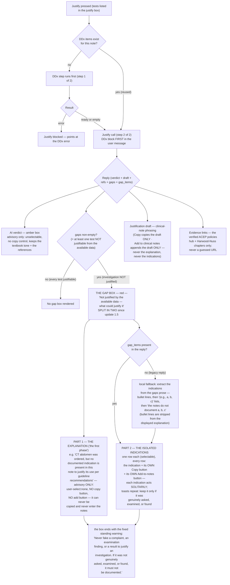
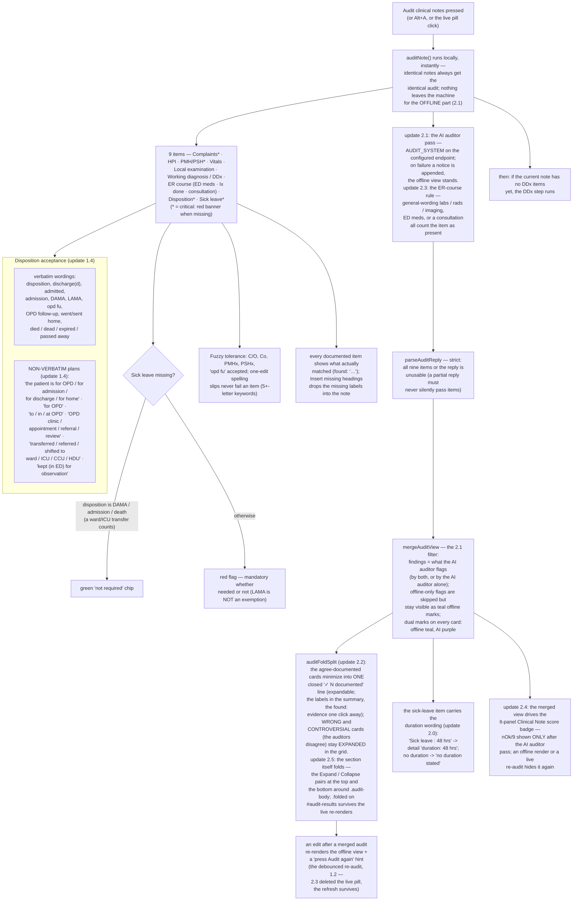

# ED Code Assist — Page Logic (update 2.8: the workup DDx gate + the audit without a DDx call + the Alt-key map + the Tintinalli index; 2.5: the diagnosis-row +, the hover rationale, the audit-section fold; 2.4: the dashboard fold, the ", + dx" DDx append, the Clinical Note entry + the AI-audit score, the codes-button rename; 2.3: the unified ICD-10 dashboard, the live-pill deletion, the AI-auditor ER-course rule; 2.2: the documented fold + the ⓘ stows + the justify-box clear; 2.1: the dual-auditor note audit + the AI-verdict filter; one-row top panel; the notes left panel)

This file documents, as Mermaid diagrams, **how the webpage actually works** — so you can compare it against the suggested design and **rectify any drift**. It is written for update 2.5 — 2.4 and 2.5 shipped together — (in 2.4: the ICD-10 dashboard folds with an **Expand / Collapse** pair beside the title and the same pair at the end of the section, and a jump into a subsection re-expands it; adding a DDx **one by one** extends an existing DDx statement — its own line or mid-paragraph — with ", + differential" instead of opening a second line; the codes button is **notes, DDX, ICD**; the left panel's Audit entry became **Clinical Note** and shows the audit score (e.g. 6/9) only after the AI auditor pass — never on the offline view. In 2.5: every differential with a suggested code carries its own **+** on the diagnosis row — one click adds its code to the selected codes; the Clinical-Based ICD coding rationale rides on the **code hover**; the audit section folds with the same top + bottom pairs). On top of update 2.3 (the DDx and ICD sections merged into ONE unified ICD-10 dashboard — the DDx-based ICD subsection first (the copy buttons deleted, + Notes / + kept, the Add-all pair at the top, every code and its buttons on one row), the Clinical-Based ICD subsection second (the listing unchanged); the live note-audit pill deleted — the debounced re-audit survives; the AI auditor now counts the ER course as documented on general-wording labs / rads or a consultation. On top of update 2.2: the audit list declutters — the agree-documented items collapse into one expandable ✓ line while wrong + controversial items stay expanded; every section's how-it-works prose sits behind a small ⓘ icon; New Patient also clears the justify box; and the 2.1 layer: the note audit runs two auditors — the offline rules locally and instantly plus an AI auditor pass on the endpoint — and the display follows the AI auditor: flagged by both, or by the AI auditor alone; offline-only flags are skipped); regenerate it after any change (see the maintenance note at the end).

Key invariants of update 2.1 (21 added by 2.8):

1. **THE DDx STEP RUNS FIRST.** It is its own AI call. The ICD-10 codes, the suggested workup and the justification of investigations all receive the DDx items in their user messages, and **none of them runs before the DDx exists**.
2. The **workup is gated**: no DDx items, no workup (a clear explanation is shown instead).
3. The **justification gap box** appears **only when at least one listed test is not justifiable from the available data** (the DDx + the clinical notes) — and it always carries the standing warning to never fake a complaint, an examination finding, or a result.
4. The audit's **offline part is local and instant** (nothing leaves the machine for it) and accepts **non-verbatim disposition plans**. Since 2.1 the button also runs an **AI auditor pass** on the endpoint, and the merged display follows the AI verdict (see invariant 13). Since 2.8 the button — renamed **only Audit notes** — makes **no DDx call** (the 1.3/1.4 keep-fresh phase was deleted) and its click **navigates to the audit section**.
5. The **Clinical Notes tab is the default tab** (the URL hash still restores the last tab).
6. There is **no Audit all button** (removed in 1.4) — every button runs the DDx step itself.
7. **The suggested workup is cross-checked against the ED CPG** (clinical governance): every suggested item on an in-play CPG section carries a **★ CG** badge, and the in-play CPG investigations the AI guidelines did not suggest are **appended as extra ★ CG cards** — so the workup also recommends the CPG file. Matching is local, deterministic, and negation-aware ("denies chest pain" / "no fever" never switches a section on).
8. **Clicking a workup card ORDERS the investigation** (click again to un-order). Each order drafts one reason sentence in the **labs-reasoning box** — since update 1.6 that sentence is the AI's **`doc` field, written for THIS encounter from the DDx + the clinical notes** (rule 6 of the workup prompt: "X is done to exclude …" documentation phrasing, varied wording, no invented findings). The local opener pools survive only as the **legacy fallback** (replies without `doc`; CPG-appended cards the review did not cover draft from the CG's curated kind + target). The box offers **Copy reasons** and **Add to clinical notes** and warns: order only what you genuinely requested.
9. **The gap box is SPLIT IN TWO (update 1.5).** The explanation — the "first phase", e.g. *"X was ordered, but no documented indication … per guideline recommendations"* — is advisory only: not selectable, **no Copy button, no Add-to-notes button** — it can never be copied and never enter the clinical notes. The **isolated indications** (`gap_items`; extracted from the prose when a legacy reply carries none) render as separate rows, **each with its own Copy and Add-to-notes button**, so every indication is handled solitarily — and the anti-faking warning stays at the bottom of the box.
10. **Four colour themes (update 1.5): Day (default) / Sepia / Dark / Night**, chosen in the header, saved in localStorage (`edca-theme`), restored **before first paint**. Every colour in the file is a CSS variable; one `data-theme` attribute on `<html>` swaps the whole palette (solid buttons keep their own dark fills so white text stays readable).
11. **CPG investigations the notes do NOT justify carry supporting data (update 1.6).** The workup reply's `cpg_review` compares every unsupported in-play CPG investigation against the other guidelines in use (ACEP / Tintinalli's / Rosen's / Harwood-Nuss') and returns the 2-4 short phrases that, had they been genuinely documented, would have justified it. The appended card renders them as **"Add supporting data like: …"** with a **⚠ needs supporting data** chip and the standing anti-faking rule — add them only if genuinely asked, examined, or found. An appended card with **no** review entry (older models) gets the softer local "verify the supporting data" note; the tool never invents supporting data itself.
12. **The Quick start & tips guide and the ⚙ Admin settings live in the TOP PANEL (update 1.6).** The guide drops down OVER the page (never pushes the content; a `:not([open])` guard hides it — Chrome renders closed-details children as boxes otherwise); the Admin button sits in the header tabs beside the theme picker.
13. **The note audit is a dual-auditor view with an AI-verdict filter (update 2.1).** The offline rules render instantly; the AI auditor pass then merges its per-item verdicts. Every card carries **both marks** (offline teal, AI purple) but the DISPLAY verdict — banner, chips, counts, Insert-missing-headings — follows the **AI auditor alone**: items flagged by both, or by the AI auditor alone, are shown as missing; items flagged **only by the offline auditor are skipped** (their offline marks stay visible). The parser is **strict on completeness** (all nine items or the reply is unusable — the offline view stands with a notice); an edit after a merged audit re-renders the offline view with a stale hint. The sick-leave item now recognizes the **duration wording** ("Sick leave : 48 hrs" → "duration: 48 hrs").
14. **The top panel is ONE ROW (update 2.1) and the Clinical Notes tab has a left panel.** The header carries the logo, the tabs, ⚙ Admin, the theme picker, the **New Patient** reset (note + results + tray, undo for the codes) and the Quick start strip on a single line; the code-helper subtitle was deleted. The notes tab carries a sticky **lt panel** — six subsection entries (Note / DDx / codes / workup / audit / justify) with icons, disabled while their section is empty, a scrollspy, and **number keys 1-6** (Notes tab only, never while typing, never over a modal or the open guide). The Keyboard shortcuts section moved into the Quick start guide; the tray's clear button is **Delete codes**; the long Data statement sits behind an expandable footer button.
15. **Update 2.2 — the decluttered audit list + the ⓘ stows.** `auditFoldSplit()` runs at render: the items the auditors **agree** are documented collapse into ONE closed `✓ N documented` line (the labels + an expand hint in the summary; one click reveals the cards and their `found:` evidence); the **wrong** items and the **controversial** ones (the two auditors disagree — a teal offline mark against the shown verdict) stay **expanded** in the grid, so the offline-only disagreements stay visible while their findings are skipped. Every long how-it-works prose block sits behind a small **ⓘ** toggle, collapsed by default (the notebar workflow line, the ai-tools explanation, the DDx hint, the codes Privacy footer, the workup header tail, the ordered-reasons hint, the justify footer, the audit rules) — the text stays verbatim inside the toggle (textContent checks unaffected; the Chrome closed-details guard applies). **New Patient** (and **Clear note & results**, the shared PHI clear) also empties the **Justify workup** box — the ordered-tests list dies with its encounter; the undo still restores the codes only.

16. **Update 2.3 — the unified ICD-10 dashboard + the pill deletion + the ER-course AI rule.** The DDx panel and the ICD code list merged into ONE dashboard (`#dash`, hidden until either subsection has content — `updateResNav` mirrors the res-nav emptiness): the first subsection is **DDx-based ICD** (`#ddx-results`, relabelled `DDx-based ICD — Suggested DDx`), the second is **Clinical-Based ICD** (`#ai-results`, relabelled; the listing unchanged). In the DDx subsection the **copy buttons are deleted** (per-item Copy, Copy all DDx, Copy DDx codes, and the inline chip's click-to-copy — the chip is plain text now); **+ Notes** (add to clinical note) and **+** (add to selected codes) stay, the **Add-all pair sits at the TOP** of the section, and every ICD code keeps its buttons **on its own row** (`.di-main` / `.di-code` are nowrap; the text wraps inside `.di-t` / `.di-cd` instead). The **live note-audit pill is deleted** (a better indicator will come later) — the debounced `refreshLiveAudit` (450 ms) survives and still refreshes a SHOWING audit panel in place (2.1 stale-hint path untouched; a PENDING pre-press timer is cancelled at the audit press — 2.3 race fix, so a keystroke from before the press can never clobber the fresh merged render with the offline view). The **AI auditor prompt** gained the ER-course rule: investigations in general wording (labs / bloods / Ix / rads / imaging, with or without results, no heading needed), ED medications given, or a consultation in any form all count the item as present.

17. **Update 2.4 — the dashboard fold, the doctor-phrasing DDx append, the Clinical Note entry.** The unified dashboard carries an **Expand / Collapse** pair **beside the title** and the **same pair at the end of the section** (either collapses or expands both subsections; the `.folded` class sits on `#dash` itself, so a re-render of either subsection keeps the folded state; the res-nav and lt-panel jumps **re-expand** a folded dashboard — a jump target must never stay hidden; Clear note & results / New Patient reset the folded state for the next encounter). Adding a DDx **one by one** now reads like a doctor: when the note already carries a DDx statement — its own line **or mid-paragraph** — `+ Notes` rewrites ONLY the DDx segment (`DDx:` / `D/Dx:` / `DD:` / `differential diagnosis` / `working diagnosis` label with a `:-/` separator, running to the first sentence period, newline or end) extending it with **", + differential."**; an empty `DDx:` label receives the differential directly; with no DDx statement the original fresh-line append stands. The codes button is renamed **notes, DDX, ICD** (the net of the 2.4 and 2.5 specs — the id, the title, the Ctrl+Enter contract and the two-step behaviour are untouched). The lt-panel entry **Audit** became **Clinical Note** (icon + key-5 shortcut unchanged) and carries a score badge driven by `ltPanelSync` from `lastAudit.ai` — **only the merged AI-audit view shows it** (`nOk/9`); an offline render, or the live re-audit that follows a note edit, hides it again.

20. **Update 2.7 — the guideline references run on ACEP, cited by topic.** NICE is retired from the whole reference system (the owner's report: the NICE citations were "not that good" — the UK guideline IDs were a hallucination magnet and UK-centric for a US-textbook ED tool). The workup and justify prompts now name **ACEP — the American College of Emergency Physicians — cited by clinical-policy topic** (`"ACEP clinical policy - Suspected Venous Thromboembolism"`), with the invented-policy-ID ban written into the never-guess rules; Tintinalli's / Rosen's / Harwood-Nuss' and the department CPG are untouched. `citationLink()` maps every ACEP citation to the **verified ACEP clinical-policies hub** (`https://www.acep.org/patient-care/clinical-policies` — a stable landing page, never a guessed deep URL, exactly like the doctorlib base for Harwood-Nuss), and the `justifyCitations` legacy scan canonicalises both ACEP forms (`"policy - Topic"` and `"policy on topic"`) with the topic trimmed at punctuation and connector words. The historical What's-new 1.6 entry keeps its NICE wording — the changelog records history, it is not rewritten.
19. **Update 2.6 — one code per differential, always.** The DDx step's prompt (rule 5) no longer returns `"ddxCodes": []` when the note documents a working diagnosis — that clause had left the documented case with **no codes at all**, so the 2.5 diagnosis-row **+** never appeared on the owner's typical notes. The AI now returns **one entry per differential in every case** (the documented working diagnosis included; `null` only when no standard billable code plausibly fits), and the pipeline keeps the pairing honest end to end: `parseDDxReply` aligns `ddxCodes` to the **sanitized** `ddx` by **raw index** (sanitizeDdx may drop entries — dups, non-strings, >80 chars, past 6 — and a drop must never shift a code onto the wrong differential), and `runDDxRequest` validates **each entry in place** (`validateAIList([e])` per slot; a missing or invalid code becomes `null` at its own index, never dropped — dropping would shift the pairing). `renderDDx` treats a `null` slot as "no code": no code row, no **+** on that differential, and the Add-all-codes button + the how-to tail gate on `.some(c => c)` while the Add-all loop skips the nulls. The **+ Notes** buttons are untouched.
21. **The 2.8 DDx gate:** Suggested workup is disabled until notes, DDX, ICD has generated DDx items for the CURRENT note (`wkDdxGate()` — re-applied by `lockAll(false)`, the note-input listener and `clearNoteResults`); the workup then reuses the DDx with **no DDx call of its own**, and any note edit closes the gate again. The keyboard map is Alt+Q codes · Alt+A workup · Alt+Y AI justify · Alt+N new patient (global); Ctrl+Enter and Alt+W are retired, and the audit button carries no shortcut. The Tintinalli 9th-ed. index (304 verified chapters) rides the workup + justify prompts exactly like the Harwood-Nuss index, and only chapter ids present in the verified list ever link.
18. **Update 2.5 — the diagnosis-row +, the hover rationale, the audit fold.** In **DDx-based ICD** every differential with a suggested code carries its own **+** on the diagnosis row (`.di-main .addbtn`, styled as a `dtool`): one click runs the same `addTray(code, 'DDx', desc)` as the code row's +, and `refreshAddBtns` manages it identically (it flips to a green ✓ once the code is in the tray) — differentials **without** a code get no button; the code row keeps its own +. In **Clinical-Based ICD** the coding rationale moved onto the **code chip's title tooltip** ("Coding rationale: … — click to copy this code", quotes escaped so an AI phrase can never break the attribute) — the visible `.rat` line and its CSS are retired, the listing stays lean, and the click-to-copy is untouched. The **Clinical notes audit** section folds with the same shared `.tgl` pair — one beside the title (inside `.ai-head`) and one at the bottom (`.audit-foot`) — around a `.audit-body` wrapper that hides when `#audit-results` carries `.folded`; the class sits on the container, so it **survives the innerHTML re-renders** (the live re-audit included), and Clear note & results resets it with the encounter.

---

## 1. Page structure & data flow

---

## 2. THE DDx-FIRST PIPELINE (the core of update 1.4)

Every AI feature goes through the same gate. `ddxReady(note)` is true when the **last DDx run was for this exact note and returned items** — the DDx is fetched **once per note** and reused by every button.

### The workup gate + the CPG cross-check + ordering (update 1.4 part 2; dynamic reasons + supporting data since 1.6)

```mermaid
flowchart TD
    WKPRESS["Suggested workup button<br/>(2.8: Alt+A)"] --> WGATE{"DDx items exist for<br/>THIS note? (the wkDdxGate —<br/>the button itself is disabled<br/>until the codes run answers yes)"}
    WGATE -- "no (button disabled —<br/>the press does nothing,<br/>the tooltip says to run<br/>notes, DDX, ICD first)" --> GATED["GATED — nothing sent; a programmatic<br/>press gets the 'needs the DDx items first —<br/>run notes, DDX, ICD' explanation"]
    WGATE -- "yes (reused — NO DDx call, the<br/>2.8 token-saving change)" --> SECS

    SECS["CPG sections in play? — the CG's embedded<br/>CPG dataset (v1.0-seed placeholder until the<br/>CG's real file replaces it) matched by keyword<br/>against the DDx items + the note<br/>NEGATION GUARD: 'denies chest pain',<br/>'no fever' never switch a section on"]
    SECS -- "none in play" --> CALL["Workup call — DDx-targeted, no CPG block"]
    SECS -- ">= 1 section in play" --> CALL2["Workup call — DDx FIRST + notes +<br/>DEPARTMENT CPG block (rules 5-7: include<br/>every CPG item the DDx/findings support,<br/>cited 'ED CPG (clinical governance)'; every<br/>item also returns its doc sentence — rule 6;<br/>the unsupported CPG items are reviewed — rule 7)"]

    CALL --> MERGE
    CALL2 --> MERGE["LOCAL CPG CROSS-CHECK (cpgMerge) —<br/>guaranteed regardless of what the AI did:<br/>1. every suggested item that matches an<br/>in-play CPG investigation (alias match)<br/>gains the ★ CG badge — including items the<br/>AI cited to ACEP / Tintinalli's / Rosen's /<br/>Harwood-Nuss' (cross-marked: on the CPG<br/>AND suggested by the other guidelines)<br/>2. in-play CPG investigations no suggested<br/>item covers are APPENDED as extra ★ CG<br/>cards, guideline 'ED CPG — clinical governance'<br/>3. (update 1.6) an appended card the reply's<br/>cpg_review flags is NOT justified by the<br/>DDx + notes carries the ⚠ needs-supporting-data<br/>annotation: the other-guidelines comparison<br/>(also_in) + 'Add supporting data like: …'<br/>(the supporting phrases) + the anti-faking<br/>rule; no review entry → the softer local<br/>'verify the supporting data' note"]

    MERGE --> WKPANEL["Workup panel: 'based on the N suggested DDx items<br/>+ the clinical notes' + CPG counts in the header<br/>('X of Y on the ED CPG (★ CG) · Z added from the CPG ·<br/>K need supporting data · AI-drafted reason')<br/>chapter citations link to the reference"]

    WKPANEL --> CARD["Click a card ⇒ ORDER the investigation<br/>(click again to un-order; ✕ in the box un-orders too)<br/>card turns green + '✓ ordered' chip"]
    CARD --> BOX["LABS-REASONING BOX (only while >= 1 ordered)<br/>one drafted sentence per order — since 1.6 the<br/>AI's doc sentence VERBATIM, written for THIS<br/>encounter from the DDx + the notes (rule 6:<br/>'X is done to exclude …' documentation phrasing,<br/>varied wording, no invented findings)<br/>a flagged card's row carries the ⚠ marker<br/>LEGACY FALLBACK (replies without doc): the CG's<br/>curated kind + target, else the opener pools"]
    BOX --> BTNS["Copy reasons (one sentence per line) ·<br/>Add to clinical notes (appends under 'Ix reasons:') ·<br/>standing reminder: order only what you genuinely<br/>requested — never document an investigation<br/>that was not ordered"]
```

---

## 3. The justification reply & the gap box (updates 1.3 → 1.5 of the request list)

The gap box is the box at the level of justification that appears **only when the investigation done is not justified by the available data from the DDx and the clinical notes**. Since update 1.5 it is **split in two**: the explanation ("the first phase") is advisory-only and can never be copied or added to the notes, while the isolated indications below it act on the record **one indication at a time**, each through its own buttons.

---

## 4. The clinical-notes audit (update 2.1: offline + the AI auditor)

---

## 5. Copy / add rules (what can ever enter the record)

| Element | Copyable? | Can reach the clinical notes? |
|---|---|---|
| Suggested DDx item | update 2.3: no copy button — **+ Notes** only | yes — "DDx: …" per item; since 2.4 an existing DDx statement (own line or mid-paragraph) is EXTENDED with ", + dx" instead; or the human phrase for all (Add all DDx) |
| Inline DDx code | update 2.3: plain text (the click-to-copy went with the copy buttons) — **+** adds to the tray (since 2.5 a **+** sits on the diagnosis row too) | via the tray (never auto-documented) |
| AI code suggestions | yes (click; + adds to the tray); since 2.5 the coding rationale rides on the code hover (title tooltip), the visible line is retired | via the tray |
| Suggested workup card | via its drafted reason (clicking ORDERS it) | via the labs-reasoning box only |
| Ordered-investigation reason | **yes — Copy reasons (one per line)** | **yes — Add to clinical notes appends under "Ix reasons:"** |
| **CPG needs-supporting-data note** (update 1.6) | display-only (selectable text, no buttons) | never auto-added — the "add supporting data like …" phrases name what to VERIFY; they enter the record only if genuinely asked, examined, or found |
| Justification verdict | **no** — unselectable, no copy control | **never** |
| **The gap-box explanation** (the "first phase") | **no** — unselectable, no copy control, no add button | **never** — it exists to remind, never to enter the record |
| **The gap-box isolated indications** (update 1.5) | **yes — each indication copies on its own** | **yes — each indication appends on its own line, after verifying it was genuinely asked, examined, or found** |
| Justification draft | **yes — Copy copies the draft only** | yes — Add appends the draft only |
| Evidence links | display-only (open to verify) | never |

---

## Maintenance

- Source of truth: `scripts/ed_code_assist_template.html` (rebuild with `python3 scripts/build_ed_code_assist.py`).
- The CPG dataset: `scripts/cpg_source.md` → `scripts/build_cpg.py` → embedded — **currently a clearly-marked placeholder (v1.0-seed)**; replace the source with the CG's real CPG Markdown (format documented in the file header) and re-run both builders.
- After ANY change to the flow, update this file in the same commit — it exists so drift is visible.
- The AI prompts themselves are documented verbatim in `PROMPT.md` (DDx, codes, workup, justify, and since 2.1 the AI auditor); the regression suites that pin this logic live in `scripts/test_update06.sh` … `scripts/test_update14.sh`, `scripts/test_update14b.sh`, `scripts/test_update15.sh`, `scripts/test_update16.sh` and `scripts/test_update21.sh` … `scripts/test_update28.sh` (plus the unit suites `test_update09_unit.mjs`, `test_update10_unit.mjs`, `test_update11_unit.mjs`, `test_parse_just_reply.mjs`, `test_workup_doc.mjs`, `test_update21_unit.mjs` … `test_update28_unit.mjs` — the last five pin the gap_items + 1.6 doc/cpg_review contracts, the 2.1 audit-parser/merge/filter + sick-leave-duration contracts, the 2.2 fold split + justify-box clear + ⓘ-stow contracts, the 2.3 dashboard/pill-deletion/ER-course-rule contracts, and the 2.4/2.5 contracts: the two folds, the ", + dx" append, the renames, the AI-only score, the diagnosis-row + and the hover rationale).
- The theme system: every colour is a CSS variable on `:root`; the three override blocks are `html[data-theme="sepia" / "dark" / "night"]` in the template. The picker is `#theme-select` in the header; the storage key is `edca-theme`; the pre-paint restore script sits in `<head>`.

*ED Code Assist update 2.8 · the logic above is verified by 999 automated checks (555 e2e + 444 unit) across the suites.*
